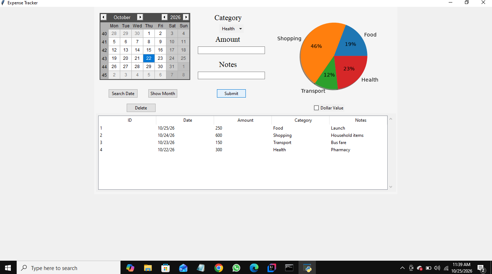
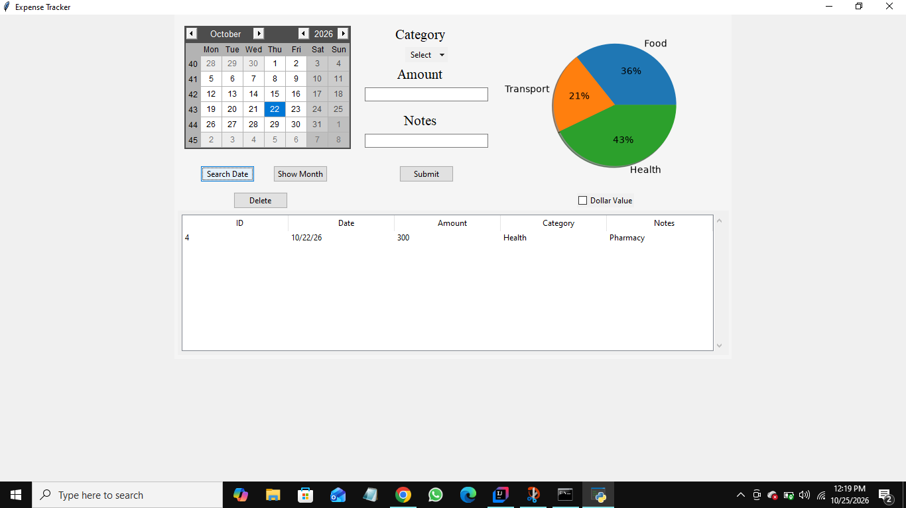

# Python Expense Tracker

A desktop application for recording expenses and reviewing spending by category. Built using Python, Tkinter, SQLite, and Matplotlib.

## Features

- Add expenses with date, amount, category, and notes.
- Search expenses by date and view records for a selected month.
- View and delete expense records.
- Display category-wise spending using pie charts.
- Switch chart labels between percentages and dollar values.
- Store expense records in an SQLite database.

  ## Screenshots

### Main Dashboard


### Dollar Chart


### Date Search


## Technologies Used

- Python
- Tkinter
- SQLite
- Matplotlib
- tkcalendar
- ttkwidgets

## How to Run

1. Install Python 3.
2. Clone this repository:

   ```bash
   git clone https://github.com/vishalsingh-28R/python-expense-tracker.git
   ```

3. Open the project folder:

   ```bash
   cd python-expense-tracker
   ```

4. Install the required packages:

   ```bash
   python -m pip install -r requirements.txt
   ```

5. Run the application:

   ```bash
   python Expense_Tracker.py
   ```

## Project Files

- `Expense_Tracker.py` — Application interface and expense management.
- `backend.py` — SQLite database operations.
- `requirements.txt` — Required Python packages.

## Author

Vishal Singh

GitHub: https://github.com/vishalsingh-28R

LinkedIn: https://www.linkedin.com/in/vishal-singh-155bb8445
